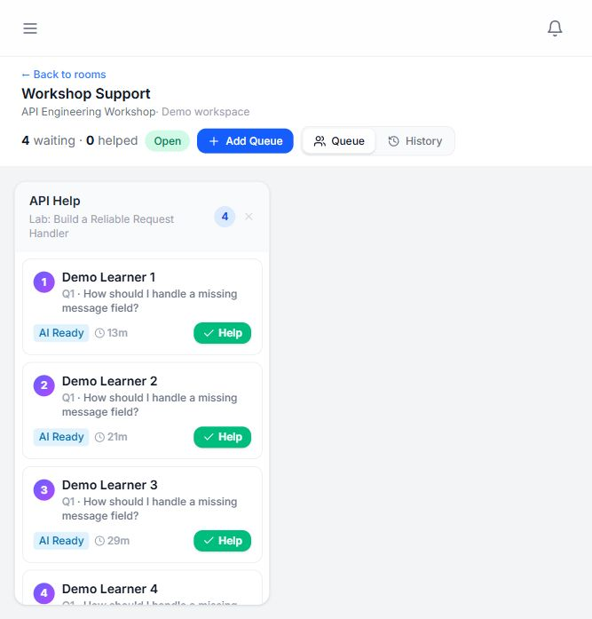
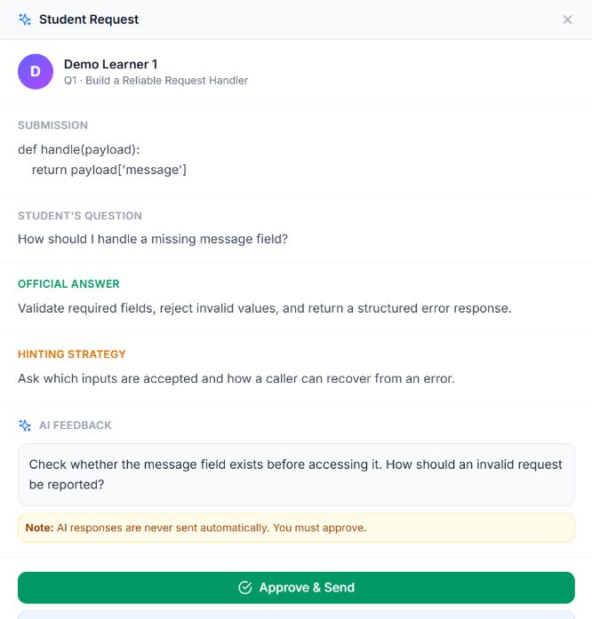
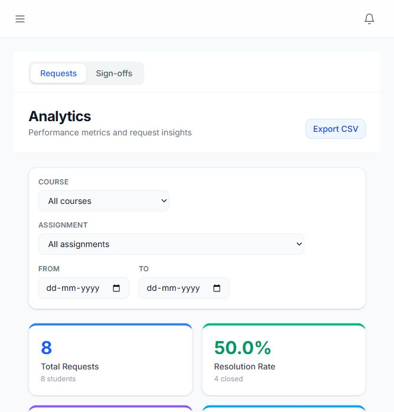
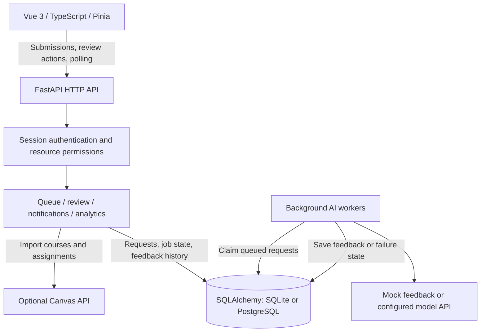

# IZEM

An AI-assisted feedback and live support platform built with **Vue 3, TypeScript, FastAPI, and SQLAlchemy**. Participants submit questions and join support queues; reviewers inspect AI-generated suggestions, approve or edit feedback, and manage requests through completion.

The system keeps AI generation outside the submission handler. Requests and job state are stored in the database, background workers generate suggestions, and the browser polls for queue and progress updates. Human review remains the final step before feedback is delivered.

## Contents

- [Preview](#preview)
- [Architecture](#architecture)
- [Engineering decisions](#engineering-decisions)
- [Features](#features)
- [Request lifecycle](#request-lifecycle)
- [Data model](#data-model)
- [Tech stack](#tech-stack)
- [Repository layout](#repository-layout)
- [Running locally](#running-locally)
- [HTTP API](#http-api)
- [Configuration](#configuration)
- [Testing](#testing)
- [Implementation tradeoffs](#implementation-tradeoffs)

## Preview

**Live queue:** participants, queue positions, AI readiness, and reviewer actions in one view.



<details>
<summary>AI feedback review</summary>



</details>

<details>
<summary>Analytics dashboard</summary>



</details>

All screenshots use the synthetic dataset included in this repository.

## Architecture

IZEM runs as a Vue frontend and a FastAPI backend. The backend owns authentication, resource permissions, queue operations, AI jobs, and persistence. In the built configuration, FastAPI also serves the compiled frontend.



| Layer | Responsibility |
| --- | --- |
| Frontend | Role-aware navigation, typed API calls, request forms, queue views, feedback review, and dashboards |
| Routes and permissions | Session validation, resource access checks, input validation, and HTTP responses |
| Services | Request transitions, reviewer ownership, background AI work, notifications, and analytics |
| Persistence | Users, enrollments, sessions, queues, requests, model configuration, and review history |

Queue views generally refresh every five seconds; the dedicated review page polls every three seconds. See [the architecture overview](docs/architecture.md) for the main implementation files.

## Engineering decisions

- **Persist AI work with the request.** Submission creates both the help request and its queued AI state. Workers claim work with a conditional database update, so competing workers can check whether their claim succeeded. Old processing jobs are requeued when the worker service starts.
- **Run model calls outside the submission handler.** Background workers use `asyncio.to_thread` for synchronous feedback generation. Participants can see their queue position while generation proceeds, and a slow model call does not keep the original submission request open.
- **Require reviewer ownership before changing feedback.** A conditional update claims an unassigned request. Review actions check ownership and return a conflict when another reviewer owns the request. This coordinates reviewers working from independently refreshed views.
- **Apply permissions at the resource boundary.** Backend helpers check access to courses, assignments, rooms, and individual requests. Vue route guards shape navigation; the API performs its own authorization checks.
- **Keep the local demo self-contained.** SQLite, fictional accounts, and mock feedback make the core workflow available without email, Canvas, or model credentials. PostgreSQL and external model configuration remain available through the existing backend.
- **Use explicit review history.** Feedback actions record the reviewer and response, alongside request timestamps used for resolution and review analytics.

## Features

### Participant experience

- Submit text and attach images or documents to a help request.
- Join a support queue and track position, AI progress, and final feedback.
- Leave a queue and view request history and progress.
- Receive in-app notifications when feedback becomes available.

### Reviewer experience

- Inspect waiting requests and claim a request for review.
- Compare the submission, reference answer, hinting strategy, and generated feedback.
- Approve feedback, edit the response, or move the request to in-person support.
- Retry AI generation after a failure and manage open queues.

### Session management and analytics

- Configure courses, assignments, questions, and model settings.
- Manage rooms with separate queues and track active sessions.
- Configure sign-off checkpoints and record individual or group progress.
- View request status, resolution times, AI review activity, and reviewer statistics.
- Export request and sign-off analytics as CSV.
- Optionally import courses, assignments, and membership through Canvas.

The UI retains the domain roles `student`, `ta`, and `teacher`; these correspond to participants, reviewers, and instructors in the demo.

## Request lifecycle

```text
Participant submits a request
  -> API checks enrollment, queue access, input, and attachment limits
  -> database saves the request, queue position, and queued AI state
  -> worker claims queued work and marks it processing
  -> mock or configured model generates a feedback suggestion
  -> database saves AI feedback and marks the request AI-generated
  -> reviewer claims the request
  -> reviewer approves, edits, or chooses in-person support
  -> database saves final feedback, review history, and resolution timing
  -> participant sees the result on the next refresh
```

Request status and AI job state are separate:

| State | Meaning |
| --- | --- |
| Request: `pending` | Waiting for AI generation or reviewer action |
| Request: `ai_generated` | A suggestion is available for review |
| Request: `approved` / `edited` | A reviewer has accepted or replaced the suggestion |
| Request: `in_person` / `resolved` | The request has been handled through the corresponding workflow |
| AI job: `queued` / `processing` | Waiting for a worker or currently generating feedback |
| AI job: `failed` | Generation failed; the request records an error and can be retried |

A worker checks the request status again before saving generated feedback. If a reviewer has already handled the request, the AI result is not applied to it.

## Data model

The schema is defined in [app/models/db.py](app/models/db.py).

| Model | Purpose |
| --- | --- |
| `User`, `AuthToken` | Role, identity, email login tokens, and active sessions |
| `Course`, `CourseEnrollment`, `TAAssignment` | Course ownership, participant enrollment, and reviewer access |
| `Assignment`, `Question` | Work items, reference answers, hinting strategies, and queue configuration |
| `Session`, `LLMConfig` | Active help sessions and model endpoint configuration |
| `QueueRoom` | Rooms and their child queues |
| `HelpRequest` | Submission, queue position, assigned reviewer, AI state, feedback, and timing |
| `FeedbackHistory`, `Notification` | Review actions and user notifications |
| `SignoffFlow`, `SignoffPoint`, `SignoffRecord` | Checkpoint definitions and recorded outcomes |
| `GroupCategory`, `Group`, `GroupMember` | Group organization and membership |

SQLite is the default. The connection layer also accepts PostgreSQL URLs through the Psycopg driver. Database initialization creates the schema and applies compatibility updates in application code.

## Tech stack

| Area | Technologies |
| --- | --- |
| Frontend | Vue 3 Composition API, TypeScript, Vue Router, Pinia |
| Styling and UI | Tailwind CSS, Lucide icons, shared Vue components |
| Frontend tooling | Vite, vue-tsc, ESLint, Prettier |
| Backend | Python, FastAPI, Uvicorn |
| Persistence | SQLAlchemy, SQLite; PostgreSQL via Psycopg |
| AI integration | Configurable model HTTP API, background workers, mock feedback |
| Authentication | Email magic links and database-backed session cookies |
| Testing | pytest, FastAPI TestClient, Vitest, Vue Test Utils, happy-dom |
| CI | GitHub Actions for backend tests, frontend tests, type checking, and builds |

## Repository layout

```text
.
├── app/
│   ├── main.py                  # App lifecycle and built frontend hosting
│   ├── auth/                    # Resource permission checks
│   ├── models/                  # SQLAlchemy schema and database initialization
│   ├── repositories/            # Shared database queries
│   ├── routes/                  # Authentication, application, and sign-off APIs
│   └── services/                # AI workers, queues, review, notifications, analytics
├── frontend/
│   └── src/
│       ├── app/
│       │   ├── api/             # Typed API client
│       │   ├── components/      # Shared UI and queue components
│       │   ├── stores/          # Pinia state
│       │   └── views/           # Role-specific screens
│       └── test/                # Component, store, view, and API client tests
├── scripts/seed_demo.py          # Fictional local demo dataset
├── unit-tests/                   # Backend API and workflow tests
├── docs/                        # Architecture and demo screenshots
├── .github/workflows/ci.yml      # Validation pipeline
├── .env.example                 # Normal configuration template
└── .env.demo.example            # Local demo configuration template
```

## Running locally

### Prerequisites

- Python 3.11 or later.
- Node.js 22 or later and npm.
- For the demo, no external database, email service, or model account is required.

Run the following from the repository root.

### 1. Install backend dependencies

```sh
python -m venv .venv
```

Activate the environment:

```powershell
# Windows PowerShell
.\.venv\Scripts\Activate.ps1
```

```sh
# macOS / Linux
source .venv/bin/activate
```

```sh
python -m pip install -r requirements.txt
```

### 2. Configure and seed the demo

```powershell
# Windows PowerShell
Copy-Item .env.demo.example .env
```

```sh
# macOS / Linux
cp .env.demo.example .env
```

```sh
python scripts/seed_demo.py
```

The script creates a fictional API engineering workshop, eight participants, one reviewer, and active and resolved requests. Running it again detects the existing demo and leaves it unchanged.

### 3. Build and start

```sh
cd frontend
npm ci --legacy-peer-deps
npm run build
cd ..
uvicorn app.main:app --host 127.0.0.1 --port 8000
```

Open [localhost:8000](http://localhost:8000). Select an account on the login page and submit the form.

| Account | Experience |
| --- | --- |
| `teacher@example.com` | Configuration, queues, and analytics |
| `ta@example.com` | Live queue and feedback review |
| `student@example.com` | Request submission and progress |

Demo mode uses mock feedback and enables direct login for demo users. Keep this configuration on a local development server.

### Frontend development

Run the backend and frontend in separate terminals:

```sh
# Terminal 1: repository root, Python environment activated
uvicorn app.main:app --reload --host 127.0.0.1 --port 8000
```

```sh
# Terminal 2
cd frontend
npm run dev
```

Vite normally serves the UI at `http://localhost:5173` and proxies `/api` and `/uploads` to the backend on port 8000. Use the built configuration for the complete email login redirect flow.

## HTTP API

The application API uses the `/api` prefix. Authenticated endpoints read the `session_token` cookie and perform role and resource access checks. The table below highlights the core workflow; [Swagger UI](http://localhost:8000/docs) and [OpenAPI JSON](http://localhost:8000/openapi.json) provide the full schema while the server is running.

| Method | Path | Purpose |
| --- | --- | --- |
| `POST` | `/api/auth/login` | Request an email login link or use an enabled demo account |
| `POST` | `/api/auth/logout` | End the current session |
| `GET` | `/api/me` | Get the authenticated user |
| `GET` | `/api/courses` | List accessible courses |
| `GET` | `/api/room/{room_id}/queue` | Read a room's queues and waiting requests |
| `POST` | `/api/student/help/submit` | Submit a multipart help request |
| `GET` | `/api/student/request/{request_id}/status` | Read request status and final feedback |
| `POST` | `/api/ta/request/{request_id}/claim` | Claim a request for review |
| `POST` | `/api/ta/request/{request_id}/approve` | Approve generated feedback |
| `POST` | `/api/ta/request/{request_id}/edit` | Deliver edited feedback |
| `POST` | `/api/ta/request/{request_id}/retry-ai` | Retry AI generation |
| `GET` | `/api/analytics` | Read request analytics |
| `GET` | `/api/analytics/export.csv` | Export analytics |
| `POST` | `/api/canvas/import` | Import a course using configured Canvas access |

Email login links are verified at `/auth/verify`, outside the `/api` prefix. The active frontend uses HTTP polling for updates; the repository's WebSocket manager is not wired into a registered WebSocket route.

## Configuration

Use `.env.demo.example` for the synthetic demo, or `.env.example` for email and external service configuration. Restart the backend after changing environment variables.

| Variable | Purpose | Default or demo value |
| --- | --- | --- |
| `DATABASE_URL` | SQLAlchemy connection URL | Demo: `sqlite:///./izem-demo.db` |
| `APP_URL` | Base URL for links in email | `http://localhost:8000` |
| `ALLOW_TEST_ACCOUNTS` | Enable direct login for predefined demo accounts | Normal: `false`; demo: `true` |
| `ALLOW_DEV_LOGIN_FOR_EXISTING_USERS` | Enable direct login for existing users | Normal: `false`; demo: `true` |
| `MOCK_LLM_MODE` | Generate local mock feedback | Normal: `false`; demo: `true` |
| `EMAIL_HOST`, `EMAIL_PORT`, `EMAIL_USER`, `EMAIL_PASS` | SMTP configuration | Configure privately for email login |
| `CANVAS_API_BASE` | Optional Canvas instance URL | Placeholder: `https://canvas.example.com` |
| `AI_QUEUE_WORKERS` | Background worker count | `1` |
| `AI_QUEUE_POLL_INTERVAL_SECONDS` | Idle worker polling interval | `1.0` seconds |
| `AI_QUEUE_STALE_SECONDS` | Processing age used for startup recovery | `180` seconds |

For real AI generation, disable mock mode and configure a model endpoint, API key, and model name through AI Settings, then select a configuration for the active session. Model configuration is stored in the database. `.env`, databases, uploads, and local dependencies are excluded from Git.

## Testing

```sh
# Repository root, Python environment activated
python -m pip install -r requirements-dev.txt
python -m pytest unit-tests -q
```

```sh
cd frontend
npm run type-check
npm test
npm run build
```

The portfolio validation run passed **67 backend tests** and **142 frontend tests**, plus frontend type checking and the production build.

Backend tests exercise authentication, role restrictions, review actions, queue counting, and sign-off access. Frontend tests cover API clients, Pinia stores, shared components, and role-specific views. GitHub Actions runs the backend suite and frontend checks on pushes and pull requests.

## Implementation tradeoffs

- **Polling adds refresh latency.** Queue updates generally become visible on the next five-second refresh. WebSocket push would require wiring the connection manager into the API and frontend.
- **Queue-position coordination is process-local.** A Python lock serializes position assignment within one backend process. Multiple API processes need stronger database coordination before claiming equivalent behavior.
- **AI execution can repeat after recovery.** Queued state survives process restarts, but startup recovery can retry an interrupted model call. The worker design does not guarantee exactly-once external execution.
- **Attachments are stored on local disk.** Uploads have extension checks and a 10 MB size limit. The current feedback generator uses submitted or extracted text; attaching an image or PDF does not by itself provide OCR or multimodal model processing.
- **Schema updates run in application initialization.** A versioned migration workflow would make database changes easier to manage across deployed environments.
- **The demo is configured for local use.** Production deployment needs HTTPS cookie settings, protected upload delivery, and secure storage for model credentials.

---

Developed collaboratively across the frontend, backend, AI integration, and testing. This portfolio edition uses neutral branding and fictional demo content.
