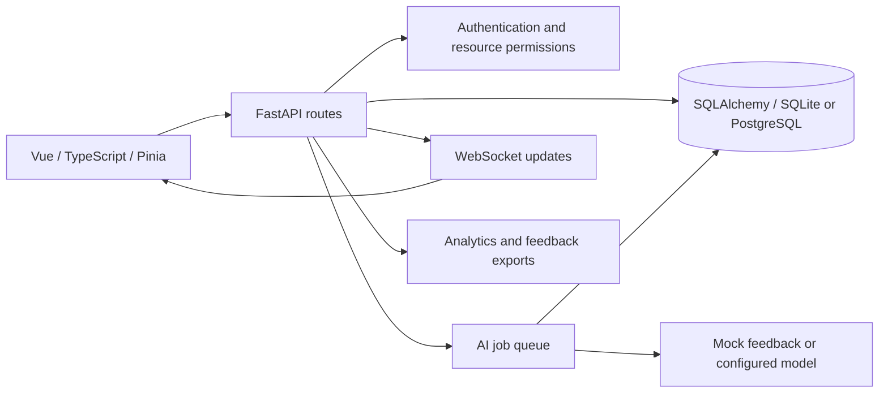

# Architecture

## Frontend

Vue views use Pinia stores and a typed API client. Route guards select the appropriate participant, reviewer, or instructor experience. Components display queue position, review actions, notifications, and progress.

## Backend

FastAPI routes validate access to courses, rooms, assignments, and requests. Services handle queue state, AI jobs, analytics, notifications, and exports. SQLAlchemy models represent users, sessions, queues, requests, and feedback history.

## Feedback lifecycle

A submission enters a queue. Background AI work records progress and generated feedback. A reviewer claims the request and approves or edits the response. The request records final feedback and resolution timing, which feed analytics and participant progress views.

## Demo boundaries

The synthetic seed script creates fictional accounts and a workshop with active and resolved requests. Mock AI avoids credentials and network calls. SQLite provides a simple local setup; the database configuration also supports PostgreSQL. Canvas integration is optional and defaults to a placeholder hostname.
